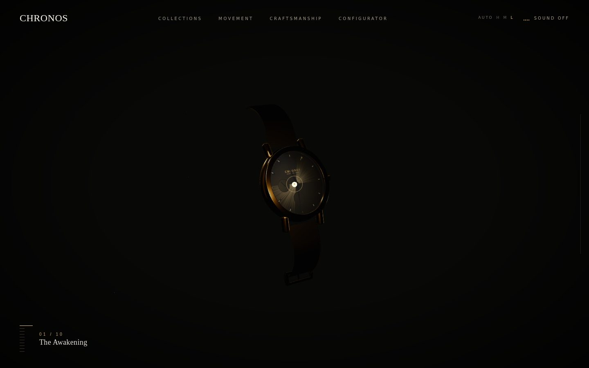
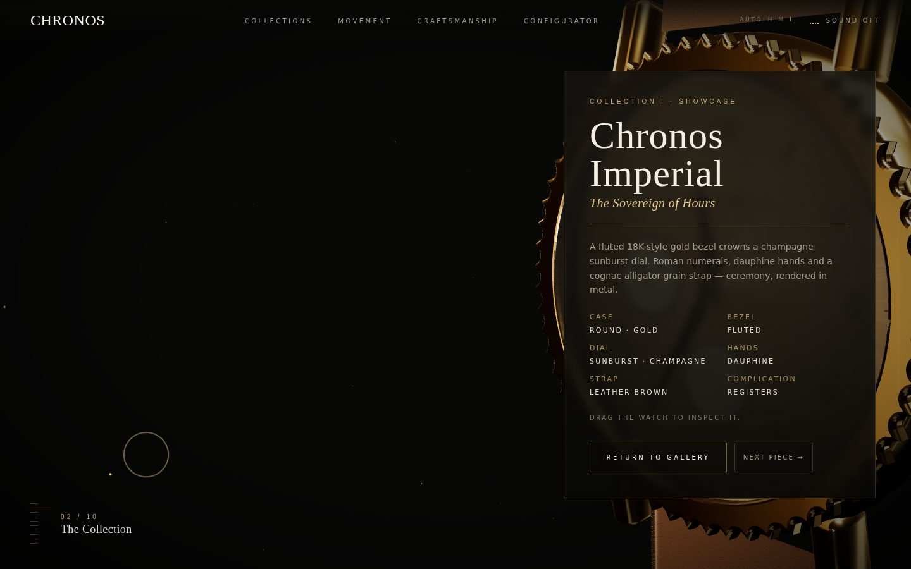
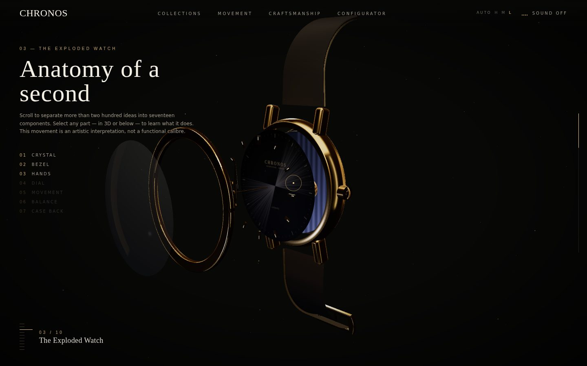
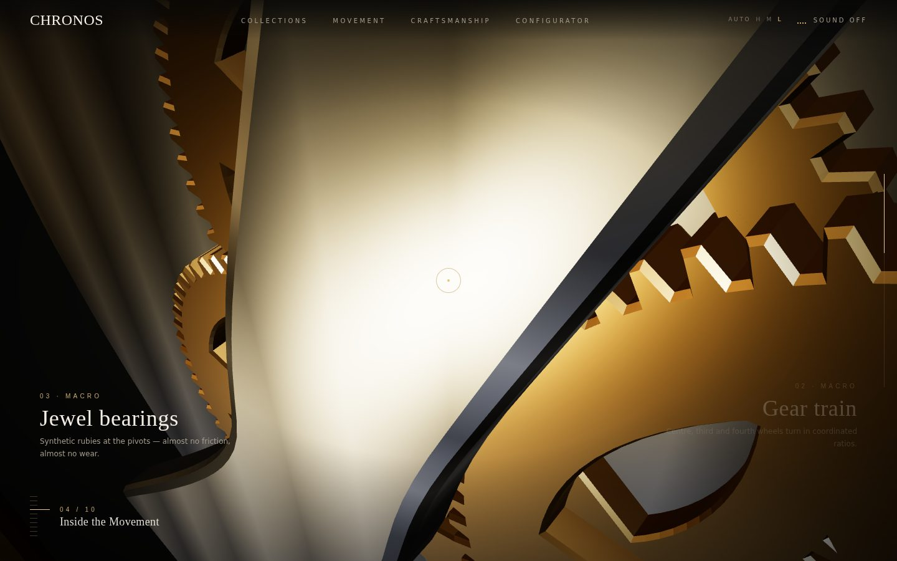
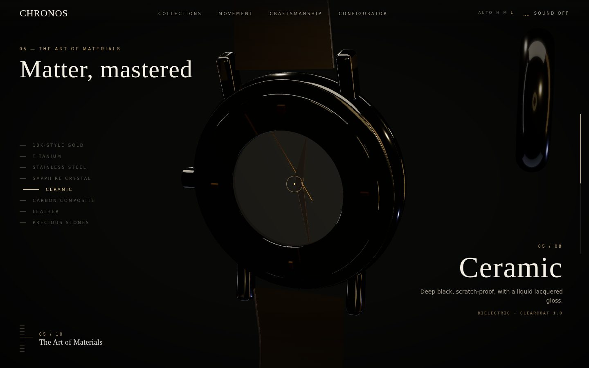
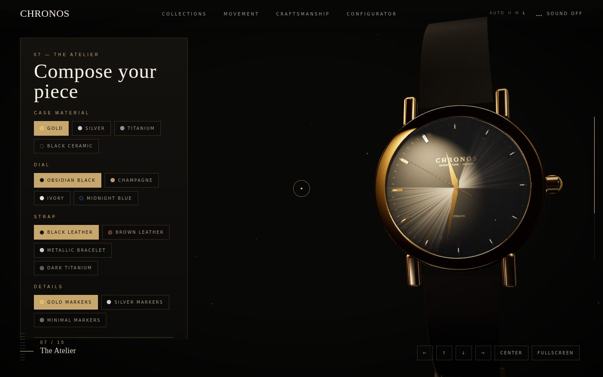
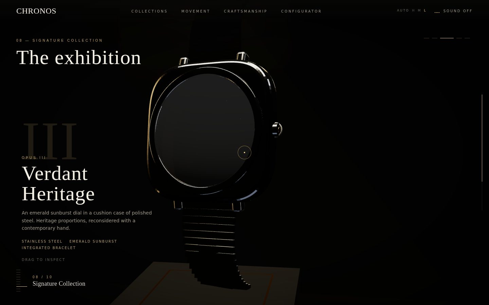
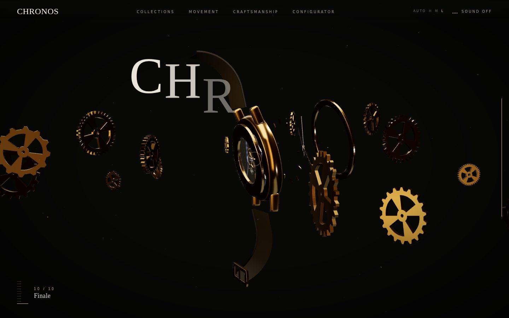

# CHRONOS — The Art of Time

> _Every second is a masterpiece._

## Visual showcase

### CHRONOS cinematic film — 16:9

<video width="100%" controls playsinline preload="metadata">
  <source src="https://raw.githubusercontent.com/ver-dev9/chronos-luxury-watch/main/chronos-showreel-16x9.mp4" type="video/mp4">
  Your browser does not support inline playback. Open the [CHRONOS cinematic film](https://raw.githubusercontent.com/ver-dev9/chronos-luxury-watch/main/chronos-showreel-16x9.mp4).
</video>

### Website screenshots

| Intro | Collection |
|:---:|:---:|
|  |  |

| Exploded watch | Movement |
|:---:|:---:|
|  |  |

| Materials | Configurator |
|:---:|:---:|
|  |  |

| Signature collection | Finale |
|:---:|:---:|
|  |  |

---

An immersive luxury watch showcase featuring cinematic 3D product visualization, interactive mechanical watch exploration, scroll-driven storytelling, WebGL, Three.js, React Three Fiber, GLSL shaders and GSAP animations.

**CHRONOS is a fictional brand.** This is a creative-development portfolio piece: there is no store, no checkout, no inventory and no accounts. Nothing here is for sale.

---

## 1. Project overview

CHRONOS is a ten-chapter, scroll-driven 3D exhibition built around a single protagonist: a mechanical watch floating in darkness. Every watch, case, dial, hand, gear, spring, strap and buckle is **generated procedurally in Three.js at runtime** — the site ships no 3D model files and no bitmap textures.

| #   | Chapter              | What happens                                                                                                           |
| --- | -------------------- | ---------------------------------------------------------------------------------------------------------------------- |
| 01  | The Awakening        | Black screen → golden light → dust → silhouette → reflections → title. Scroll orbits and dives.                        |
| 02  | The Collection       | Horizontal 3D rail of four distinct watches synced to a DOM gallery; hover/drag rotate; _Explore Collection_ showcase. |
| 03  | The Exploded Watch   | Scroll-controlled disassembly into 17 labelled, clickable components; disassemble / reassemble / slider controls.      |
| 04  | Inside the Movement  | Macro camera journey through the case aperture across barrel, train, escapement and balance with depth of field.       |
| 05  | The Art of Materials | Case cross-fades through 8 PBR materials while the camera orbits; a dedicated specimen per material.                   |
| 06  | The Art of Time      | Cathedral-scale clockwork: meshing giant gears, Roman chapter ring, pendulum, volumetric light.                        |
| 07  | The Atelier          | Real-time configurator (case, dial, strap, markers), rotate controls, fullscreen, summary, cinematic reveal.           |
| 08  | Signature Collection | Five pieces on plinths under shafts of light, presented as an exhibition; drag to inspect.                             |
| 09  | The Craftsmanship    | Six animated atelier vignettes: machining, gear cutting, polishing, assembly, dial finishing, inspection.              |
| 10  | Finale               | Components reassemble inside a gold-dust vortex; final orbit, credits, footer.                                         |

## 2. Creative concept

High-end watch advertising meets the experimental web. Darkness is the canvas; light is the brush. The watch is never decoration on a page — the page is staged around the watch. Typography is editorial and restrained, gold is an accent rather than a fill, and effects are used only where they carry meaning (light reveals metal; dust shows air; the veil marks a change of act).

## 3. Brand identity

| Token          | Hex       | Use                       |
| -------------- | --------- | ------------------------- |
| Ink            | `#080807` | Primary background        |
| Night          | `#11100D` | Secondary background      |
| Charcoal       | `#171511` | Panels                    |
| Champagne gold | `#C7A76B` | Accent, rules, labels     |
| Light gold     | `#E4C88D` | Highlights, active states |
| Warm ivory     | `#F5F0E5` | Display type              |
| Muted          | `#A39B8A` | Body copy                 |

Typefaces: **Cormorant Garamond** (display serif) and **Inter** (body sans), with widely tracked uppercase labels.

## 4. Key features

- Ten chapters, each with its own lazily-loaded 3D scene and scrubbed GSAP timeline
- Procedural watch system: one `WatchModel` renders 10+ distinct designs from a `WatchSpec` (round / cushion / octagon cases; smooth, fluted, tachymeter, gem-set and screwed bezels; sunburst, guilloché, enamel, carbon and skeleton dials; dauphine, baton, leaf, sword hands; leather, rubber, steel and titanium bracelets; registers and a tourbillon)
- Exploded view with staggered, eased separation, labels, selectable parts (outline highlight + pulse), keyboard-accessible component list and full reversibility
- Procedural movement with coordinated motion: stepping escape wheel, rocking pallet fork, oscillating balance, breathing hairspring, train wheels, barrel and mainspring
- Hands that show the visitor's real local time
- Live configurator with instant model updates, fullscreen viewer and a cinematic reveal
- Generative WebAudio soundscape (drone + escapement tick), muted by default
- Three rendering quality tiers with automatic performance-based switching
- Reduced-motion mode, touch support, custom desktop cursor, responsive layouts

## 5. Technology stack

React 18 · TypeScript · Vite 5 · Tailwind CSS 3 · Three.js r169 · React Three Fiber 8 · Drei 9 · @react-three/postprocessing 2 / postprocessing 6 · GSAP 3 + ScrollTrigger · Lenis · Zustand 5 · ESLint 9 · Prettier.

## 6. Architecture

```
            ┌─────────────── DOM (pointer-events: none) ────────────────┐
 Lenis ─▶   │ 10 <Section>s  · tall scroll tracks, pinned stages         │
 ScrollTrigger │ per-chapter scrubbed GSAP timelines (typography)       │
            └───────────────┬───────────────────────────────────────────┘
                            │ progress (mutable, no React renders)
                            ▼
                    store/scrollState.ts  ◀── pointer / drag
                            │
 Zustand (useExperience) ── chapter, quality, config, selection (rare changes)
                            │
            ┌───────────────▼──── single fixed <Canvas> ─────────────────┐
            │ SceneDirector → mounts ONE lazy chapter scene at a time      │
            │ Effects (quality-tiered) · StudioEnvironment · LiquidGold    │
            └──────────────────────────────────────────────────────────────┘
```

- **High-frequency data** (scroll progress, velocity, pointer, drag) lives in a plain mutable object and is read in `useFrame`. React state changes only when a chapter, selection or option actually changes.
- **SceneDirector** mounts exactly one chapter scene (code-split with `React.lazy`), preloads neighbours, and hides swaps behind a liquid-gold veil or a short black dip. Unmounted scenes release their GPU resources.
- **Camera rigs** (`useCameraRig`) map damped chapter progress to a target pose and ease the real camera toward it — so scrolling backwards plays every move in reverse.

## 7. Folder structure

```
src/
  app/            App shell, Canvas (Experience), SceneDirector, Effects, studio environment
  animations/     Lenis + ScrollTrigger sync, chapter triggers, timeline hook, intro state
  audio/          Generative WebAudio sound engine
  components/     navigation, cursor, loading, ui (progress), sections (DOM per chapter)
  data/           chapters, watch specs & collections, component copy, materials, craft steps
  hooks/          reduced motion, pointer, global drag-to-rotate
  models/         WatchModel, WatchCase, Dial, WatchHands, Strap, Movement, Gear, BalanceWheel, explode system
  scenes/         intro · collections · exploded-watch · movement · materials · time · configurator · signature · craftsmanship · finale
  shaders/        particles (GoldDust), gold (LiquidGold), transitions (LightSweep, VolumetricBeam), shared simplex noise
  store/          Zustand store + mutable scroll state
  utils/          procedural geometry, procedural textures, material library, math
```

## 8. Installation

```bash
git clone https://github.com/<you>/chronos-luxury-watch.git
cd chronos-luxury-watch
npm install
```

Requires Node 18+ (developed on Node 22).

## 9. Local development

```bash
npm run dev       # http://localhost:5173
npm run lint      # ESLint (flat config)
npm run format    # Prettier
```

## 10. Production build

```bash
npm run build     # type-check + Vite build → dist/
npm run preview   # serve dist/ locally
```

Vendor code is split into `three`, `r3f`, `post` and `motion` chunks; each chapter scene is its own chunk.

## 11. 3D asset pipeline

There are **no external model files**. All geometry is authored procedurally (`src/utils/geometry.ts`) and cached:

- Gears: polygonal tooth profiles with spoked webs, extruded and bevelled; Swiss-lever escape wheel with club teeth
- Cases: lathe-turned round cases with a curved flank; extruded, bevelled octagon and superellipse cushion cases
- Bezels: annular extrusions, scalloped for fluting; instanced gems; screw heads
- Hands: extruded dauphine / baton / leaf / sword / needle profiles
- Straps: a custom swept rectangular profile along a wrist-curl path; bracelets as instanced links on the same path
- Springs: Archimedean spirals swept as thin tubes
- Movement: mainplate with cut-outs, spline-swept bridges, instanced jewels and screws

Textures (sunburst/guilloché/enamel/carbon dials, tachymeter scale, carbon weave, leather grain bump, brushed roughness, Côtes de Genève stripes) are drawn on `<canvas>` at load and shared.

Because nothing is downloaded, **Draco / Meshopt / KTX2 are not needed today**. If photogrammetry or CAD-derived GLBs are added later, the recommended pipeline is:

```bash
npx @gltf-transform/cli optimize in.glb out.glb --compress meshopt --texture-compress ktx2
```

and load with Drei's `useGLTF` (Draco/Meshopt decoders) plus `KTX2Loader`.

## 12. Animation system

- **Lenis** drives smooth scroll; its `scroll` event calls `ScrollTrigger.update()` and Lenis is ticked from `gsap.ticker` (one RAF for both).
- **Per-chapter ScrollTriggers** (`useChapterTriggers`) write progress into `scrollState`, flip the active chapter and pin each chapter's stage inside its own tall track (`pinSpacing: false`, so no pin-spacing jumps).
- **Per-chapter GSAP timelines** (`useChapterTimeline`) are scrubbed, created inside `gsap.context` and reverted on unmount — they reverse and refresh cleanly.
- **3D motion** is computed in `useFrame` from damped progress (`THREE.MathUtils.damp`), writing directly to Three.js objects.
- The **intro** is a time-based GSAP timeline animating light, dust, silhouette, camera approach and reflections before the title reveal.

## 13. Shader implementation

| Shader          | File                                     | Notes                                                                                                           |
| --------------- | ---------------------------------------- | --------------------------------------------------------------------------------------------------------------- |
| Golden dust     | `shaders/particles/GoldDust.tsx`         | GPU points; simplex-noise drift, pointer repulsion, staged reveal, vortex "flow" mode, scroll-velocity speed-up |
| Liquid gold     | `shaders/gold/LiquidGold.tsx`            | Full-screen veil with noise-carved molten edge, used at selected chapter boundaries                             |
| Volumetric beam | `shaders/transitions/VolumetricBeam.tsx` | Additive cone with rim falloff and drifting noise (fake volumetrics)                                            |
| Light sweep     | `shaders/transitions/LightSweep.tsx`     | Narrow warm spot gliding across metal (time- or reveal-driven)                                                  |
| Simplex noise   | `shaders/noise.glsl.ts`                  | Shared GLSL include                                                                                             |

Post-processing: bloom (mipmap), depth of field (movement + exhibition on HIGH), speed-reactive chromatic aberration, film grain, vignette and a selection outline in the exploded view.

## 14. Performance strategy

- Only one chapter scene is mounted at a time; scenes are lazy chunks with neighbour preloading
- Shared, cached geometries, materials and textures; instancing for gems, jewels, screws and bracelet links
- Environment reflections from a procedural Lightformer HDRI baked once (`frames={1}`)
- Quality tiers — **HIGH**: DPR ≤ 2, soft shadows 1024², full post chain, full particles · **MEDIUM**: DPR ≤ 1.5, 512² shadows, bloom + grain + vignette, ~45% particles · **LOW**: DPR ≤ 1, no shadows, no composer, ~18% particles, lighter sapphire and movement detail
- Initial tier picked from viewport and CPU cores; Drei `PerformanceMonitor` steps quality down/up automatically; users can pin a tier in the nav (H / M / L)
- Particles animate entirely on the GPU; the CPU updates three uniforms per frame

## 15. Responsive design

Desktop gets the full experience. Tablet and mobile get re-framed cameras (portrait configurator framing), stacked overlays, a hamburger menu, reduced particles via the quality tier, touch drag (horizontal drags rotate, vertical drags scroll) and a collapsible configurator panel.

## 16. Accessibility

- `prefers-reduced-motion` disables Lenis smoothing, skips the intro animation, removes veil transitions and auto-rotation, and reduces particles
- Every interaction has a DOM equivalent: component list buttons in the exploded view, rotate/tilt/center buttons in the configurator, chapter navigation buttons
- Semantic sections with labels and headings, `aria-pressed` toggles, `aria-live` regions for component info, materials and steps, a modal dialog with Escape-to-close, skip link, visible focus styles
- Sound is opt-in and never required; the canvas is `aria-hidden` and all story content exists as text
- WebGL-less browsers get a readable fallback

## 17. Demo link

**Live:** https://ver-dev9.github.io/chronos-luxury-watch/

## 18. Credits

Concept, design & development — [ver-dev9](https://github.com/ver-dev9).
Simplex noise GLSL — Ashima Arts / Stefan Gustavson (MIT).
All 3D models, textures and sounds are original and procedurally generated.

## 19. License

License to be confirmed by the author. Until a `LICENSE` file is added, all rights are reserved.

---

## Deployment guide

**Vercel** — import the repo; `vercel.json` sets `npm run build` → `dist`.

**Netlify** — import the repo; `netlify.toml` sets `npm run build` → `dist`.

**GitHub Pages** — the Vite `base` defaults to `./` (relative), so `dist/` works from any sub-path. The workflow at `.github/workflows/deploy.yml` builds on every push to `main` and publishes `dist/` to the `gh-pages` branch, which Pages serves.

The site is a single page with no client routes, so no rewrite rules are required.

## Known limitations

- The movement is an artistic interpretation with coordinated, illustrative motion — **not** a functional calibre or CAD-accurate model.
- No true per-object motion blur; speed-reactive chromatic aberration stands in for it.
- Volumetric light is faked with additive cones rather than ray-marched.
- Fonts load from Google Fonts; without network access the dial print falls back to system serif.
